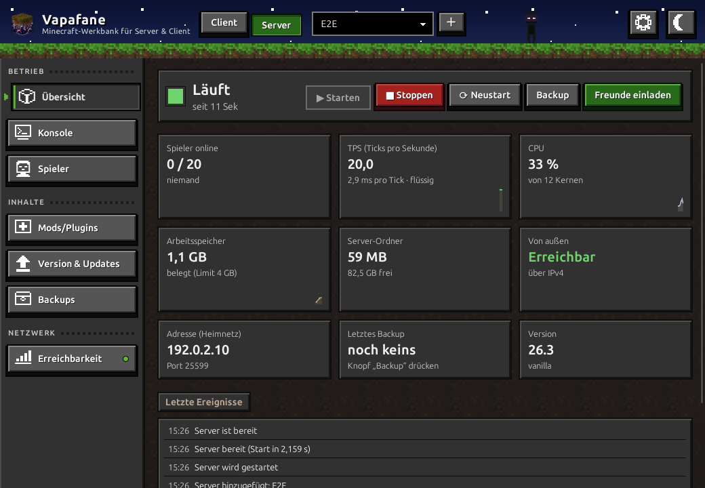
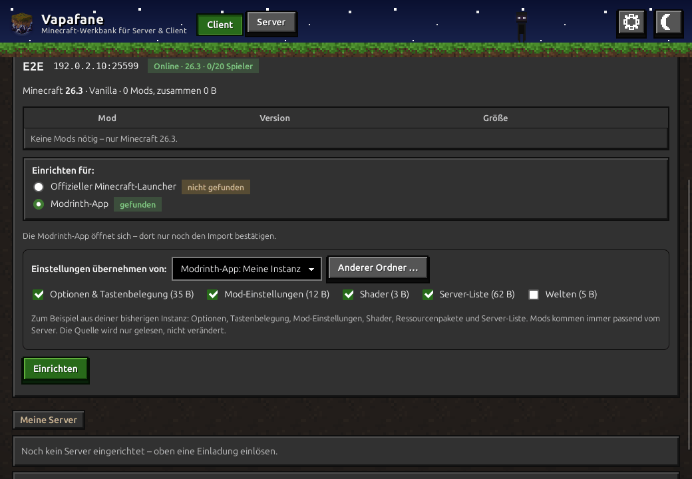
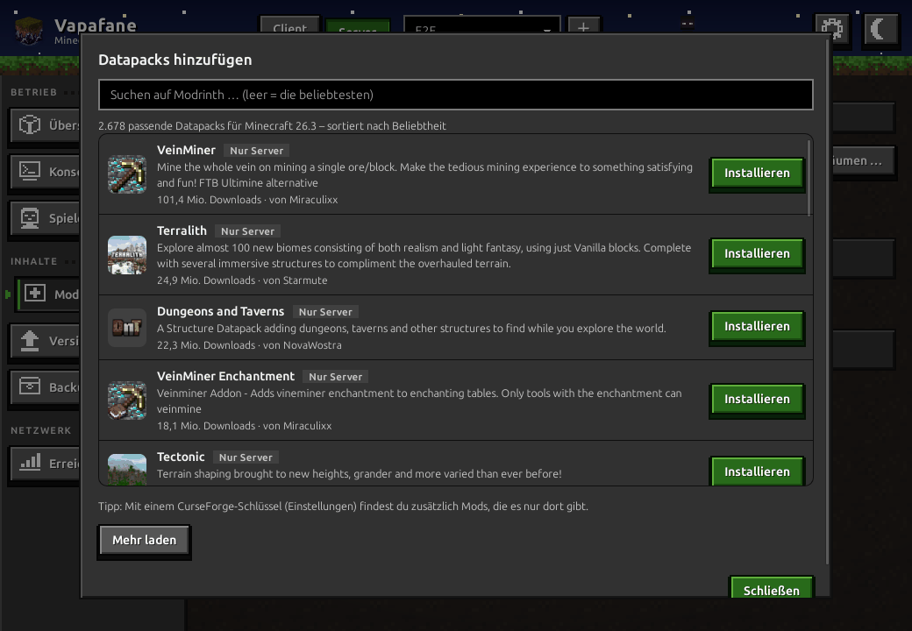

<p align="center">
  🇬🇧 <a href="README.md">English</a> · 🇩🇪 <b>Deutsch</b>
</p>

<p align="center">
  
</p>

<h1 align="center">Vapafane</h1>

<p align="center">
  <b>Minecraft-Werkbank für Server &amp; Client</b><br>
  Eigener Minecraft-Server ganz ohne Befehle – und deine Freunde spielen mit einem Einladungs-Code mit.
</p>

<p align="center">
  
  
  
  
</p>

<p align="center">
  <a href="../../releases/latest"><b>Herunterladen</b></a> ·
  <a href="#so-benutzt-du-vapafane">Anleitung</a> ·
  <a href="#häufige-fragen">Häufige Fragen</a> ·
  <a href="CHANGELOG.md">Was ist neu?</a>
</p>

<p align="center">
  
</p>

> **Hinweis:** Vapafane ist kein offizielles Minecraft-Produkt. Es ist nicht von Mojang oder
> Microsoft genehmigt und steht in keiner Verbindung zu ihnen.
> *NOT AN OFFICIAL MINECRAFT PRODUCT. NOT APPROVED BY OR ASSOCIATED WITH MOJANG OR MICROSOFT.*

## Funktionen

**Eigener Server**

- Server anlegen mit *Vanilla*, *Paper*, *Fabric* oder *NeoForge* – Version wählen, fertig
- Starten und Stoppen mit einem Klick; der Server läuft im Hintergrund weiter, auch wenn das
  Fenster zu ist, und startet nach einem Absturz neu
- Konsole, Spieler und Whitelist, Mods, Plugins und Datapacks von Modrinth (und CurseForge) –
  hinzufügen, ausschalten oder entfernen; jeder Eintrag zeigt Symbol, Kurzbeschreibung und einen
  Link zu seiner Seite, und Vapafane warnt, bevor du etwas entfernst, das andere Mods noch brauchen
- Updates mit Probelauf, tägliche Backups, Wiederherstellen mit einem Klick
- Ampel für die Erreichbarkeit von außen (IPv4 und IPv6, erkennt DS-Lite)

**Mitspielen bei Freunden**

- Einladungs-Code einlösen – Vapafane richtet den **Minecraft-Launcher** oder die
  **Modrinth-App** mit genau den Mods des Servers ein
- Einstellungen, Shader, Ressourcenpakete und Server-Liste aus der bisherigen Installation
  übernehmen
- Nach einem Server-Update die vorhandene Instanz aktualisieren, ohne etwas zu verlieren
- Anleitung für eigene Shader und Extras, Server-Status auf einen Blick

<p align="center">
  
  
</p>

## Installieren

Die Dateien gibt es bei der **[neuesten Version](../../releases/latest)**
(rechts auf dieser Seite unter „Releases“).

| System | Datei | So geht's |
|---|---|---|
| Windows 10/11 | `Vapafane_…_x64-setup.exe` | Herunterladen und starten. Erscheint „Der Computer wurde durch Windows geschützt“, auf **„Weitere Informationen“** → **„Trotzdem ausführen“** klicken (das Programm ist nicht signiert). |
| Linux (Ubuntu, Debian, Mint …) | `Vapafane_…_amd64.deb` | Im Dateimanager **doppelklicken** – oder den Befehl unten im Terminal ausführen. |

Linux direkt im Terminal – lädt immer die neueste Version und installiert sie (auch zum
Aktualisieren):

```bash
wget -O /tmp/vapafane.deb https://github.com/Debong93/Vapafane/releases/latest/download/Vapafane_amd64.deb && sudo apt install /tmp/vapafane.deb
```

**Voraussetzungen:** Windows 10/11 oder Linux, jeweils 64-bit (Ubuntu 22.04, Debian 12,
Mint 21 oder neuer). Mehr braucht es zum Mitspielen nicht – fehlt etwas (Minecraft-Launcher,
Modrinth-App, Java), sagt Vapafane es dir und zeigt, wo du es bekommst.

**Nur wer selbst einen Server betreibt,** braucht zusätzlich Java (Minecraft 26.x braucht
Java 25): Windows z. B. [Temurin von adoptium.net](https://adoptium.net), Linux
`sudo apt install openjdk-25-jre-headless`. Zum Mitspielen bei Freunden ist kein Java nötig.

Zu jeder Version gibt es eine Datei `SHA256SUMS.txt` mit Prüfsummen, falls du den Download
prüfen möchtest.

## So benutzt du Vapafane

Oben im Fenster wählst du zwischen **Client** (mitspielen) und **Server** (selbst einen
Server betreiben). Vapafane startet immer im Client-Bereich. Das **Zahnrad** oben rechts
öffnet die Einstellungen des jeweiligen Bereichs, der Knopf daneben wechselt zwischen hell
und dunkel.

### Eigenen Server erstellen

1. Oben auf **„Server“** umschalten.
2. Auf **„+“** klicken (es leuchtet, solange es noch keinen Server gibt) und
   **„Neuen Server erstellen“** wählen. Typ aussuchen – *Vanilla* (ohne Mods),
   *Fabric* oder *NeoForge* (mit Mods), *Paper* (mit Plugins) –, Minecraft-Version und
   Namen angeben und die Minecraft-EULA bestätigen. Einen vorhandenen Server-Ordner oder
   ein Backup fügst du über dasselbe Menü hinzu.
3. Unter **„Spieler“** deinen Minecraft-Namen und die deiner Freunde eintragen: Neue Server
   haben die **Whitelist** an – nur wer dort steht, kommt rein. Das schützt vor Fremden.
4. In der **Übersicht** auf **„▶ Starten“** klicken. Das Fenster darf danach zu – der
   Server läuft im Hintergrund weiter.
5. Links findest du alles Weitere: **Konsole**, **Spieler** (Whitelist, OP),
   **Mods/Plugins** („Mods hinzufügen …“ sucht auf Modrinth), **Version & Updates**,
   **Backups** und **Erreichbarkeit**.

### Freunde einladen

1. In der Übersicht auf **„Freunde einladen“** klicken.
2. Für Freunde im selben WLAN passt die vorgeschlagene Adresse. Für Freunde von außen
   **„Öffentliche Adresse ermitteln“** klicken und im Router den Server-Port freigeben
   (Anleitung für alle Router: [portforward.com](https://portforward.com/minecraft-java-edition-server/)).
3. **„Code erzeugen“** und den Code z. B. per Messenger schicken.

Unter **Erreichbarkeit** zeigt eine Ampel, ob dein Server von außen erreichbar ist –
grün über IPv4 und IPv6, gelb nur über IPv6 (z. B. bei DS-Lite), rot gar nicht.

### Mit dem Client einem Server beitreten

1. Vapafane installieren und im Bereich **„Client“** bleiben.
2. Den Einladungs-Code einfügen und **„Einladung prüfen“** klicken (oder eine
   `.vapafane`-Datei öffnen). Vapafane zeigt Server, Version und Mods.
3. Wählen, wofür eingerichtet wird – **Minecraft-Launcher** oder **Modrinth-App**.
4. Wer schon Minecraft eingerichtet hat, wählt unter **„Einstellungen übernehmen von“** seine
   bisherige Instanz: Optionen, Tastenbelegung, Mod-Einstellungen, Shader, Ressourcenpakete,
   Server-Liste und auf Wunsch Welten kommen mit. Die bisherige Instanz bleibt unverändert.
5. **„Einrichten“** klicken. Vapafane lädt die passenden Mods und legt ein Profil an.
6. Unter **„Meine Server“** mit **„Spielen“** den Launcher öffnen. Ob der Server gerade
   online ist, siehst du direkt daneben. **„Shader & Extras“** zeigt Schritt für Schritt, wie
   du eigene Shader, Ressourcenpakete oder Mods hinzufügst.

**Nach einem Server-Update** schickt dir der Admin einen neuen Einladungs-Code – denn welche
Version und welche Mods dazugehören, steht in der Einladung. Code einlösen, fertig: Beim
Minecraft-Launcher aktualisiert Vapafane das Profil direkt. Bei der Modrinth-App baut
Vapafane ein neues Paket und zeigt, wie du damit deine vorhandene Instanz aktualisierst
(„Instanz-Einstellungen“ → „Installation“ → „Modpack neu installieren“) – Welten,
Einstellungen und Shader bleiben erhalten.

Vapafane startet Minecraft nicht selbst und fasst kein Microsoft-Konto an.

## Häufige Fragen

**Windows warnt beim Installieren.** Das Programm ist nicht digital signiert (das kostet
jährlich Geld). Auf „Weitere Informationen“ → „Trotzdem ausführen“ klicken.

**Meine Freunde kommen nicht auf den Server.** Unter **Erreichbarkeit** prüfen, ob der Port
im Router freigegeben ist. Steht der Name deines Freundes auf der **Whitelist** (Seite
„Spieler“)? Und passt seine Minecraft-Version – nach einem Update braucht er einen neuen
Einladungs-Code.

**Wo liegen meine Daten?** Server liegen im Ordner `MC_Servers` in deinem Benutzerordner.
Die Spielordner der Clients öffnest du in den Client-Einstellungen über
„Spielordner aller Clients“.

**Wie deinstalliere ich Vapafane?** Windows: Einstellungen → Apps. Linux:
`sudo apt remove vapafane`. Deine Server und Backups bleiben dabei erhalten.

## Fehler melden und mitmachen

Fehler und Ideen bitte als [GitHub-Issue](../../issues) melden – es gibt Vorlagen dafür.
Bitte keine Passwörter, Einladungs-Codes oder öffentlichen IP-Adressen hineinkopieren.

## Sprachen

Vapafane startet in der Sprache deines Systems (sonst Englisch) und lässt sich in den
Einstellungen umschalten. Deutsch und Englisch sind von Hand gepflegt; Französisch, Spanisch,
Italienisch, Niederländisch, Portugiesisch, Polnisch und Türkisch sind maschinell übersetzt –
Korrekturen sind willkommen. Die Texte liegen in [`locales/`](locales), eine Datei je Sprache.

## Für Entwickler

Komplett in Rust; jede Komponente hat eine eigene kurze README:

| Ordner | Inhalt |
|---|---|
| [`src-tauri/`](src-tauri/README.md) | das Programm: Fenster, Hintergrund-Dienst, Befehlszeile |
| [`frontend/`](frontend/README.md) | die Oberfläche (Leptos/WebAssembly) |
| [`shared/`](shared/README.md) | gemeinsame Datentypen |
| [`werkzeuge/`](werkzeuge/README.md) | erzeugt die Pixel-Texturen |
| [`e2e/`](e2e/README.md) | Oberflächen-Tests, die das echte Programm bedienen |

Selbst bauen:

```bash
rustup target add wasm32-unknown-unknown
cargo install tauri-cli trunk --locked
cd src-tauri && cargo tauri build
```

Testmodus ohne echte Daten: `VAPAFANE_HOME=/tmp/test vapafane`. Alle Änderungen stehen im
[Änderungsprotokoll](CHANGELOG.md).

## Lizenz

Vapafane steht unter der [MIT-Lizenz](LICENSE). Minecraft ist eine Marke von
Mojang/Microsoft; Mods und Plugins stammen von ihren jeweiligen Autoren.
