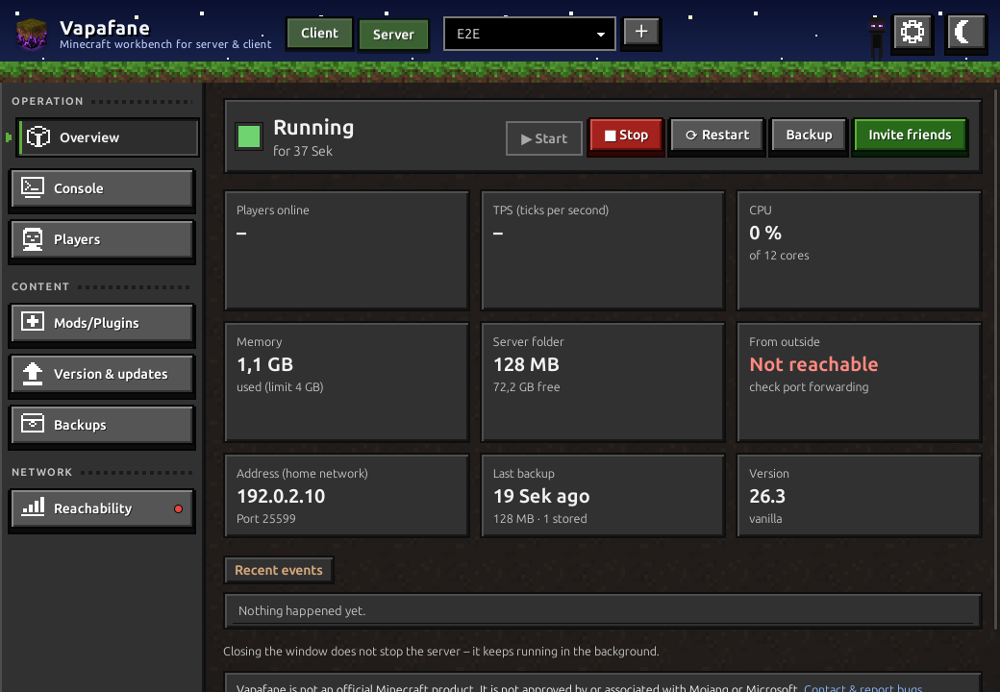

<p align="center">
  🇬🇧 <b>English</b> · 🇩🇪 <a href="README.de.md">Deutsch</a>
</p>

<p align="center">
  
</p>

<h1 align="center">Vapafane</h1>

<p align="center">
  <b>Minecraft workbench for server &amp; client</b><br>
  Your own Minecraft server without typing a single command – and your friends join with an invite code.
</p>

<p align="center">
  
  
  
  
</p>

<p align="center">
  <a href="../../releases/latest"><b>Download</b></a> ·
  <a href="#how-to-use-vapafane">Guide</a> ·
  <a href="#frequently-asked-questions">FAQ</a> ·
  <a href="CHANGELOG.md">What's new?</a>
</p>

<p align="center">
  
</p>

> **Note:** Vapafane is not an official Minecraft product.
> *NOT AN OFFICIAL MINECRAFT PRODUCT. NOT APPROVED BY OR ASSOCIATED WITH MOJANG OR MICROSOFT.*

## Features

**Your own server**

- Create a server with *Vanilla*, *Paper*, *Fabric* or *NeoForge* – pick a version, done
- Start and stop with one click; the server keeps running in the background even with the
  window closed, and restarts after a crash
- Console, players and whitelist, mods, plugins and datapacks from Modrinth (and CurseForge)
- Updates with a dry run, daily backups, one-click restore
- Traffic light for reachability from outside (IPv4 and IPv6, detects DS-Lite)

**Playing on a friend's server**

- Redeem an invite code – Vapafane sets up the **Minecraft Launcher** or the **Modrinth App**
  with exactly the server's mods
- Take over options, shaders, resource packs and the server list from your existing setup
- After a server update, refresh the existing instance without losing anything
- Step-by-step guide for your own shaders and extras, server status at a glance

## Install

Grab the files from the **[latest release](../../releases/latest)**
(under "Releases" on the right of this page).

| System | File | How |
|---|---|---|
| Windows 10/11 | `Vapafane_…_x64-setup.exe` | Download and run it. If "Windows protected your PC" appears, click **"More info"** → **"Run anyway"** (the program is not code-signed). |
| Linux (Ubuntu, Debian, Mint …) | `Vapafane_…_amd64.deb` | **Double-click** it in the file manager – or run the command below in a terminal. |

Linux straight from the terminal – always fetches and installs the latest version (also for
updating):

```bash
wget -O /tmp/vapafane.deb https://github.com/Debong93/Vapafane/releases/latest/download/Vapafane_amd64.deb && sudo apt install /tmp/vapafane.deb
```

**Requirements:** Windows 10/11 or Linux, 64-bit (Ubuntu 22.04, Debian 12, Mint 21 or
newer). That's all you need to join friends – if something is missing (Minecraft Launcher,
Modrinth App, Java), Vapafane tells you and shows where to get it.

**Only if you run a server yourself** you also need Java (Minecraft 26.x needs Java 25):
on Windows e.g. [Temurin from adoptium.net](https://adoptium.net), on Linux
`sudo apt install openjdk-25-jre-headless`. Joining friends needs no Java at all.

Every release ships a `SHA256SUMS.txt` with checksums in case you want to verify the
download.

## How to use Vapafane

At the top of the window you switch between **Client** (join others) and **Server** (run
your own). Vapafane always starts in the client area. The **gear** at the top right opens
the settings of the current area; the button next to it toggles light and dark.

### Create your own server

1. Switch to **"Server"** at the top.
2. Click **"+"** (it glows as long as there is no server yet) and choose
   **"Create a new server"**. Pick the type – *Vanilla* (no mods), *Fabric* or *NeoForge*
   (with mods), *Paper* (with plugins) –, choose the Minecraft version and a name, and
   confirm the Minecraft EULA. An existing server folder or a backup is added through the
   same menu.
3. Under **"Players"**, add your Minecraft name and your friends' names: new servers come
   with the **whitelist** switched on – only listed players get in. That keeps strangers
   out.
4. In the **overview**, click **"▶ Start"**. You may close the window afterwards – the
   server keeps running in the background.
5. Everything else is on the left: **Console**, **Players** (whitelist, OP),
   **Mods/Plugins** ("Add mods …" searches Modrinth), **Version & updates**, **Backups**
   and **Reachability**.

### Invite friends

1. In the overview, click **"Invite friends"**.
2. For friends on the same Wi-Fi the suggested address is fine. For friends outside, click
   **"Determine public address"** and forward the server port in your router
   (guide for all routers: [portforward.com](https://portforward.com/minecraft-java-edition-server/)).
3. Click **"Create code"** and send the code e.g. via messenger.

Under **Reachability**, a traffic light shows whether your server can be reached from
outside – green via IPv4 and IPv6, yellow only via IPv6 (e.g. with DS-Lite), red not at
all.

### Join a server with the client

1. Install Vapafane and stay in the **"Client"** area.
2. Paste the invite code and click **"Check invite"** (or open a `.vapafane` file).
   Vapafane shows the server, version and mods.
3. Choose what to set up – **Minecraft Launcher** or **Modrinth App**.
4. If you already have Minecraft set up, pick your existing instance under
   **"Take over settings from"**: options, key bindings, mod settings, shaders, resource
   packs, the server list and, if you want, worlds come along. Your existing instance stays
   untouched.
5. Click **"Set up"**. Vapafane downloads the matching mods and creates a profile.
6. Under **"My servers"**, **"Play"** opens the launcher. Whether the server is online
   right now is shown next to it. **"Shaders & extras"** walks you through adding your own
   shaders, resource packs or mods.

**After a server update** the admin sends you a new invite code – because the matching
version and mods are part of the invite. Redeem it, done: with the Minecraft Launcher,
Vapafane updates the profile directly. With the Modrinth App, Vapafane builds a new pack
and shows how to update your existing instance with it ("Instance settings" →
"Installation" → "Reinstall modpack") – worlds, settings and shaders are kept.

Vapafane never launches Minecraft itself and never touches your Microsoft account.

## Frequently asked questions

**Windows warns during installation.** The program is not digitally signed (that costs a
yearly fee). Click "More info" → "Run anyway".

**My friends can't reach the server.** Check under **Reachability** whether the port is
forwarded in the router. Is your friend's name on the **whitelist** (page "Players")? And
does their Minecraft version match – after an update they need a new invite code.

**Where is my data?** Servers live in the `MC_Servers` folder inside your user folder. The
clients' game folders open from the client settings via "Game folders of all clients".

**How do I uninstall Vapafane?** Windows: Settings → Apps. Linux:
`sudo apt remove vapafane`. Your servers and backups are kept.

## Languages

Vapafane starts in your system's language (English otherwise) and can be switched in the
settings. English and German are maintained by hand; French, Spanish, Italian, Dutch,
Portuguese, Polish and Turkish are machine-translated – corrections are welcome. The texts
live in [`locales/`](locales), one file per language.

## Report bugs and contribute

Please report bugs and ideas as a [GitHub issue](../../issues) – there are templates for
both, in English or German. Please don't paste passwords, invite codes or public IP
addresses.

## For developers

Written entirely in Rust; every component has its own short README:

| Folder | Contents |
|---|---|
| [`src-tauri/`](src-tauri/README.md) | the program: window, background service, command line |
| [`frontend/`](frontend/README.md) | the user interface (Leptos/WebAssembly) |
| [`shared/`](shared/README.md) | shared data types and translations |
| [`werkzeuge/`](werkzeuge/README.md) | generates the pixel textures |
| [`e2e/`](e2e/README.md) | UI tests that drive the real program |

Build it yourself:

```bash
rustup target add wasm32-unknown-unknown
cargo install tauri-cli trunk --locked
cd src-tauri && cargo tauri build
```

Test mode without real data: `VAPAFANE_HOME=/tmp/test vapafane`. All changes are listed in
the [changelog](CHANGELOG.md).

## License

Vapafane is released under the [MIT license](LICENSE). Minecraft is a trademark of
Mojang/Microsoft; mods and plugins come from their respective authors.
